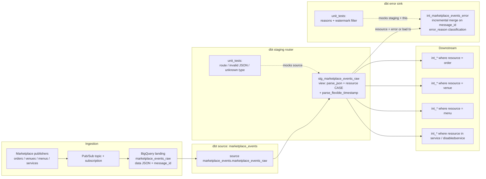
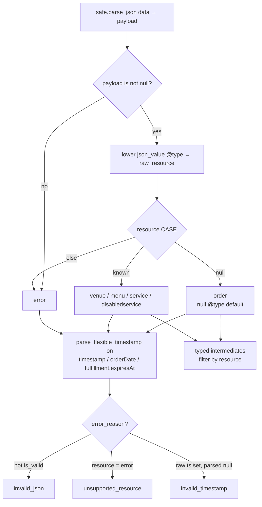

# Architecture — resource router + error sink

## Components

## Routing and quarantine logic

## Design notes

- Staging stays a **view** so the router always mirrors the latest
  subscription write; quarantine is the only materialization in this pattern.
- `full_refresh=false` on the error sink protects historical quarantine rows
  from accidental wipe during a first-of-month rebuild habit.
- Watermark lookback (1 hour) is a pragmatic late-arrival buffer, not a
  correctness proof — tune against your Pub/Sub redelivery window.
- Do not unpack nested business fields in the router; typed models own that
  after filtering on `resource`.
