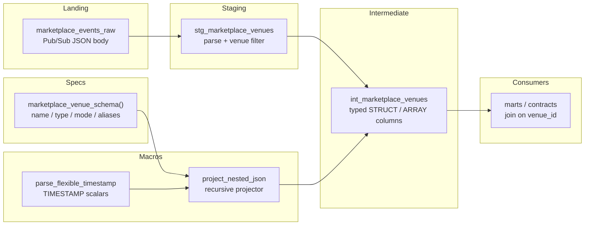
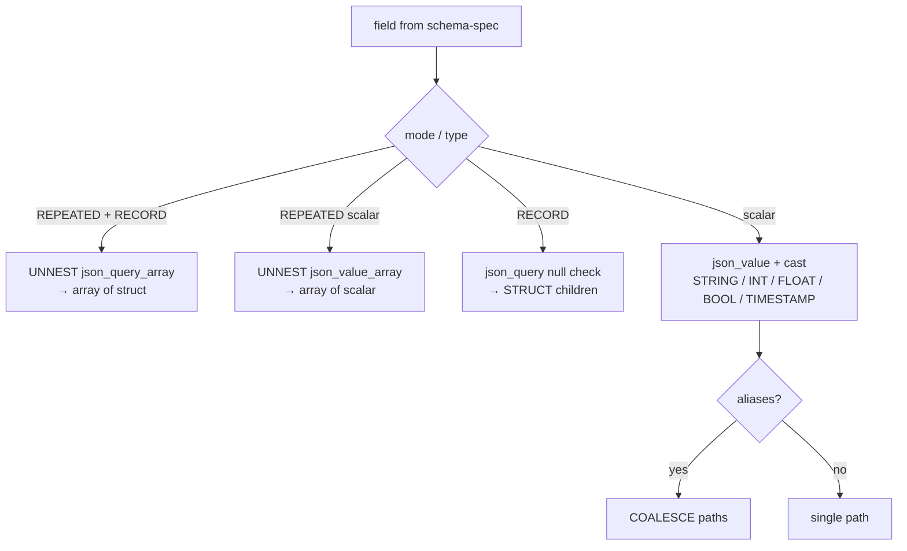
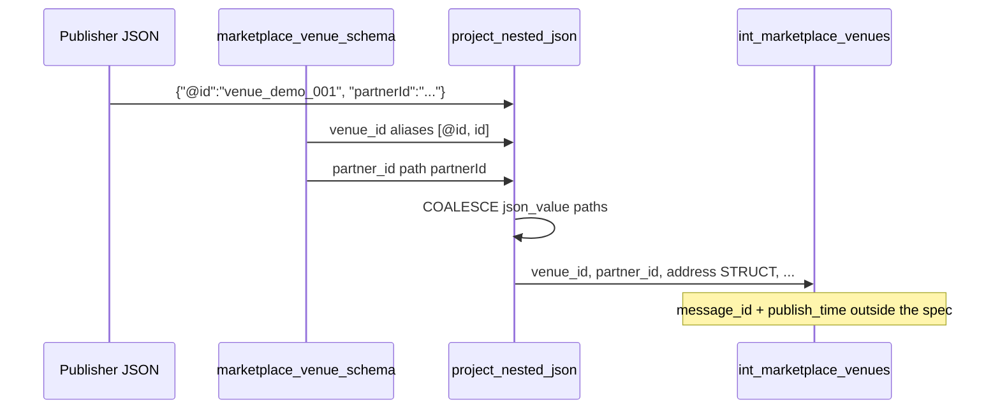

# Architecture — nested JSON project / schema-spec

## Components

## Projector decision tree

## Alias and path handling

## Design notes

- Schema-specs are data (lists of dicts), not SQL. Generate from a known
  BigQuery schema export when the legacy table is the source of truth.
- Broker columns (`message_id`, `publish_time`) stay outside the projector so
  merge keys and watermarks remain obvious in the model file.
- TIMESTAMP fields reuse `parse_flexible_timestamp` — string and epoch-millis
  both appear in marketplace payloads.
- Pattern 11's router can replace `stg_marketplace_venues` in a full project;
  this example keeps a thin filter so the folder runs conceptually alone.
