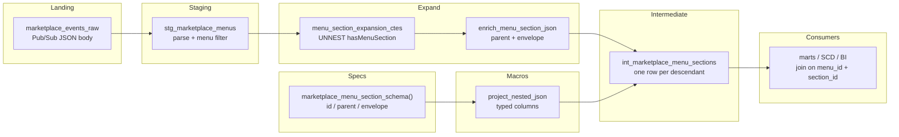
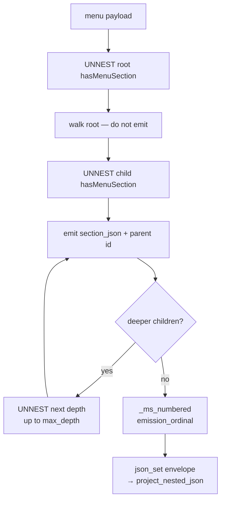
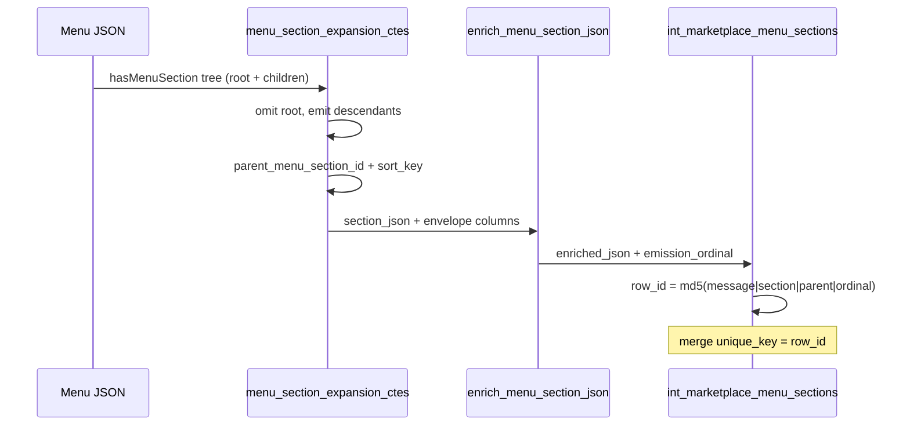

# Architecture — nested section expand

## Components

## Expansion decision tree

## Grain and merge key

## Design notes

- Roots are intentional omissions: they exist so children have a parent
  id, matching streaming unnest handlers that skip top-level section
  shells.
- `path_step` zero-pads offsets so lexicographic `sort_key` order matches
  tree walk order across depths.
- `max_depth` is a compile-time guard. Raise it only when fixtures prove
  deeper nesting; every extra depth multiplies UNION ALL CTE size.
- Broker columns (`message_id`, `publish_time`) stay outside the schema-spec
  so watermarks and merge keys remain obvious in the model.
- Pattern 12's projector is reused; this folder's lesson is the expand
  CTEs, not a second projector implementation.
